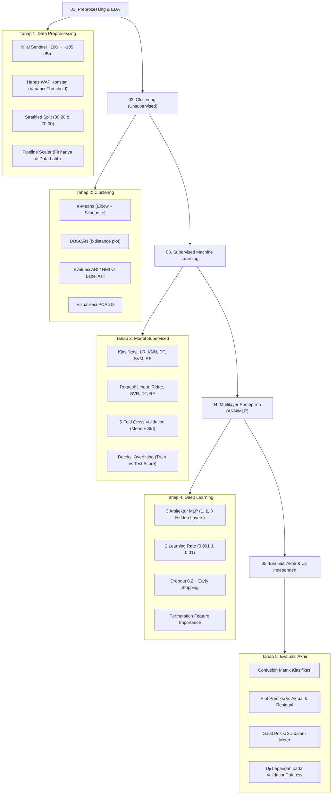

# 🛰️ Indoor Localization System: Klasifikasi & Regresi Lokalisasi Berbasis Wi-Fi RSSI Fingerprinting

[](https://www.python.org/)
[](https://scikit-learn.org/)
[](https://www.tensorflow.org/)
[](#)
[](#)

---

## 📌 Daftar Isi
1. [Sekilas Tentang Proyek & Konsep Kerja](#-sekilas-tentang-proyek--konsep-kerja)
2. [Latar Belakang & Studi Kasus Bisnis](#-latar-belakang--studi-kasus-bisnis)
3. [Tujuan Eksperimen](#-tujuan-eksperimen)
4. [Dataset & Peta Sebaran Lokasi Kampus](#-dataset--peta-sebaran-lokasi-kampus)
5. [Alur Metodologi Pengerjaan](#-alur-metodologi-pengerjaan)
6. [Rumus Matematis & Metrik Evaluasi](#-rumus-matematis--metrik-evaluasi)
7. [Daftar Model & Alasan Pemilihan](#-daftar-model--alasan-pemilihan)
8. [Galeri Visual Hasil Eksperimen & Analisis](#-galeri-visual-hasil-eksperimen--analisis)
9. [Kesimpulan & Rekomendasi Implementasi Nyata](#-kesimpulan--rekomendasi-implementasi-nyata)
10. [Panduan Instalasi & Menjalankan Proyek](#-panduan-instalasi--menjalankan-proyek)

---

## 💡 Sekilas Tentang Proyek & Konsep Kerja

### *Bayangkan Anda Berada di Dalam Gedung Kampus / Mall Raksasa...*
Ketika berada di luar ruangan, ponsel Anda dengan mudah menentukan posisi menggunakan satelit **GPS**. Namun, begitu melangkah ke dalam gedung bertingkat, sinyal GPS terhalang oleh atap beton, kaca tebal, dan dinding baja, sehingga GPS menjadi **tidak akurat bahkan mati total**.

Lalu, bagaimana aplikasi navigasi bisa mengetahui:
1. **Di gedung mana** Anda berada? *(Klasifikasi Gedung)*
2. **Di lantai berapa** Anda berdiri? *(Klasifikasi Lantai)*
3. **Di titik koordinat berapa meter persisnya** Anda berjalan? *(Regresi Posisi)*

**Jawabannya adalah Wi-Fi Fingerprinting.** Setiap sudut ruangan menerima kombinasi kekuatan sinyal Wi-Fi (*Received Signal Strength Indication* / RSSI) yang unik dari ratusan pemancar (*Access Point*) di sekitarnya. Proyek ini membangun sistem kecerdasan buatan (*Machine Learning* dan *Deep Learning*) untuk mengenali pola "sidik jari sinyal" tersebut dan memperkirakan lokasi pengguna secara presisi dalam satuan meter.

<p align="center">
  
  <br>
  <em>Gambar 1: Alur Kerja Sistem Wi-Fi Fingerprinting: Dari Sinyal Radio Mentah Menjadi Prediksi Gedung, Lantai, dan Titik Koordinat 2D.</em>
</p>

---

## 🏢 Latar Belakang & Studi Kasus Bisnis

* **Klien / Skenario Nyata:** Tim R&D PT. Sinyal Nusantara sedang mengembangkan layanan navigasi indoor terintegrasi untuk kampus universitas multi-gedung.
* **Pengambil Keputusan:** Ibu Laras *(Product Manager)* ingin memastikan apakah kombinasi sinyal Wi-Fi dari ponsel pengguna cukup andal untuk menebak gedung, lantai, dan koordinat pengguna dengan tingkat galat (error) sekecil mungkin sebelum aplikasi diluncurkan ke publik.
* **Tantangan Fisik Sinyal:**
  * Sinyal Wi-Fi memiliki rentang nilai nyata **$-104\text{ dBm}$ (sangat lemah) hingga $0\text{ dBm}$ (sangat kuat)**.
  * Jika sinyal pemancar tidak terdeteksi sama sekali oleh ponsel, dataset mencatat nilai buatan **$+100$**. Nilai ini harus dimanipulasi dengan logika fisika yang benar (misalnya diganti menjadi $-105\text{ dBm}$) agar model tidak salah mengira $+100$ sebagai sinyal super kuat.
  * Banyak pemancar Wi-Fi yang mati atau tidak pernah terdeteksi sama sekali pada gedung tertentu (*sparse/constant features*).

---

## 🎯 Tujuan Eksperimen

1. **Klasifikasi Multi-Kelas Terpisah:**
   * Memprediksi gedung (`BUILDINGID`: Gedung 0, 1, 2) secara akurat.
   * Memprediksi lantai (`FLOOR`: Lantai 0, 1, 2, 3, 4) dengan menangani ketidakseimbangan kelas data (*class imbalance*).
2. **Regresi Koordinat Terpisah:**
   * Memprediksi koordinat `LONGITUDE` dan `LATITUDE` secara presisi.
   * Melaporkan rata-rata galat posisi 2D (*Mean Euclidean Positioning Error*) dalam satuan fisik **meter**.
3. **Eksplorasi Pola Sinyal (Clustering):**
   * Menguji apakah sinyal Wi-Fi dapat mengelompok secara mandiri tanpa label menggunakan **K-Means** dan **DBSCAN**.
4. **Komparasi Machine Learning vs Deep Learning (MLP):**
   * Menguji performa model klasik (*Random Forest, SVM, KNN, Decision Tree, Ridge/Linear*) melawan jaringan saraf tiruan (*Multilayer Perceptron*) dengan variasi kedalaman layer dan *learning rate*.
5. **Evaluasi Bebas Kebocoran Data (*Zero Data Leakage*):**
   * Menjamin seluruh tahapan *scaling*, pengisian nilai kosong, dan pemilihan fitur diisolasi di dalam `Pipeline` hanya menggunakan data latih.
   * Menguji ketahanan model pada dataset validasi independen yang belum pernah dilihat sama sekali (`validationData.csv`).

---

## 📊 Dataset & Peta Sebaran Lokasi Kampus

Sumber data berasal dari [UCI Machine Learning Repository: UJIIndoorLoc Dataset](https://archive.ics.uci.edu/dataset/310), yang dikumpulkan di 3 gedung Universitas Jaume I, Spanyol.

| Karakteristik | Data Training (`trainingData.csv`) | Data Validasi Independen (`validationData.csv`) |
|---|---|---|
| **Jumlah Baris (Sampel)** | 19.937 baris | 1.111 baris |
| **Fitur Sinyal (Input)** | 520 WAP (`WAP001` – `WAP520`) | 520 WAP (`WAP001` – `WAP520`) |
| **Target Klasifikasi** | `BUILDINGID` (3 kelas), `FLOOR` (5 kelas) | `BUILDINGID`, `FLOOR` |
| **Target Regresi** | `LONGITUDE`, `LATITUDE` (satuan meter UTM) | `LONGITUDE`, `LATITUDE` |
| **Metadata (Diabaikan)** | `USERID`, `PHONEID`, `TIMESTAMP` | `USERID`, `PHONEID`, `TIMESTAMP` |

<p align="center">
  
  <br>
  <em>Gambar 2: Peta Sebaran Observasi Koordinat (Longitude vs Latitude) Pengguna di 3 Gedung Kampus Berdasarkan Data Lapangan.</em>
</p>

---

## 🔄 Alur Metodologi Pengerjaan

Eksperimen disusun secara berurutan dan terstruktur dalam **5 Tahapan Utama**:



---

## 📐 Rumus Matematis & Metrik Evaluasi

### 1. Metrik Tugas Utama: Galat Posisi 2D Euclidean (Satuan Meter)
Untuk mengukur seberapa jauh melesetnya prediksi koordinat dari posisi asli pengguna di dunia nyata dalam jarak garis lurus (*Euclidean distance*):

$$
\text{Positioning Error}_i = \sqrt{(\hat{x}_i - x_i)^2 + (\hat{y}_i - y_i)^2}
$$

$$
\text{Mean Positioning Error (MPE)} = \frac{1}{N} \sum_{i=1}^{N} \text{Positioning Error}_i
$$

> **Keterangan Variabel:**
> * $\hat{x}_i$ dan $\hat{y}_i$ (`x̂`, `ŷ`): Titik koordinat Longitude dan Latitude hasil **prediksi model** pada sampel ke-$i$.
> * $x_i$ dan $y_i$ (`x`, `y`): Titik koordinat Longitude dan Latitude **aktual / posisi nyata** pada sampel ke-$i$.
> * $N$: Jumlah total titik data pengujian.

---

### 2. Metrik Klasifikasi (Gedung & Lantai)

#### A. Akurasi (Accuracy)
Mengukur persentase tebakan kelas yang benar secara menyeluruh:

$$
\text{Accuracy} = \frac{TP + TN}{TP + TN + FP + FN}
$$

#### B. Macro F1-Score
Rata-rata harmonik antara *Precision* dan *Recall* yang dihitung secara adil untuk setiap kelas (sangat krusial untuk target `FLOOR` yang memiliki ketidakseimbangan jumlah sampel):

$$
\text{Precision}_k = \frac{TP_k}{TP_k + FP_k}, \quad \text{Recall}_k = \frac{TP_k}{TP_k + FN_k}
$$

$$
\text{F1-Score}_k = 2 \times \frac{\text{Precision}_k \times \text{Recall}_k}{\text{Precision}_k + \text{Recall}_k}
$$

$$
\text{Macro F1} = \frac{1}{K} \sum_{k=1}^{K} \text{F1-Score}_k
$$

> **Keterangan:** $K$ adalah jumlah total kelas ($K=3$ untuk gedung, $K=5$ untuk lantai).

---

### 3. Metrik Regresi (Longitude & Latitude)

#### A. Mean Absolute Error (MAE)
Rata-rata selisih absolut antara nilai prediksi dan nilai nyata (dalam meter):

$$
\text{MAE} = \frac{1}{N} \sum_{i=1}^{N} |y_i - \hat{y}_i|
$$

#### B. Root Mean Squared Error (RMSE)
Akar rata-rata kuadrat galat yang memberikan penalti lebih berat pada kesalahan prediksi yang berjarak jauh:

$$
\text{RMSE} = \sqrt{\frac{1}{N} \sum_{i=1}^{N} (y_i - \hat{y}_i)^2}
$$

#### C. Koefisien Determinasi ($R^2$)
Mengukur seberapa besar proporsi variansi koordinat aktual yang mampu dijelaskan oleh model ($1.0$ berarti prediksi sempurna):

$$
R^2 = 1 - \frac{\sum_{i=1}^{N}(y_i - \hat{y}_i)^2}{\sum_{i=1}^{N}(y_i - \bar{y})^2}
$$

---

### 4. Metrik Clustering (K-Means & DBSCAN)

#### A. Silhouette Coefficient
Mengukur seberapa rapat titik data berada di dalam kelompoknya ($a$) dibandingkan jarak ke kelompok tetangga terdekat ($b$). Rentang nilai antara $-1$ hingga $+1$:

$$
s(i) = \frac{b(i) - a(i)}{\max(a(i), b(i))}
$$

#### B. Davies-Bouldin Index (DBI)
Mengukur rasio kesamaan antar-cluster. Semakin kecil nilainya ($< 1.0$), semakin baik dan terpisah pemisahan antar-cluster:

$$
DB = \frac{1}{k} \sum_{i=1}^{k} \max_{j \neq i} \left( \frac{s_i + s_j}{d(c_i, c_j)} \right)
$$

#### C. Adjusted Rand Index (ARI) & Normalized Mutual Information (NMI)
Mengukur seberapa akurat pengelompokan tanpa label (*unsupervised clustering*) mencerminkan label fisik asli gedung dan lantai di lapangan:

$$
\text{ARI} = \frac{\text{Index} - \text{ExpectedIndex}}{\text{MaxIndex} - \text{ExpectedIndex}}
$$

---

## 🤖 Daftar Model & Alasan Pemilihan

| Model | Kategori Tugas | Alasan Ilmiah Pemilihan |
|---|---|---|
| **Random Forest** | Klasifikasi & Regresi | **Pilihan Utama (Ensemble Tree).** Sangat tahan terhadap fitur sinyal yang jarang (*sparse*), mampu menangani hubungan non-linear kompleks antar-WAP, dan tidak mudah *overfitting*. |
| **K-Nearest Neighbors (KNN)** | Klasifikasi & Regresi | Karakteristik fisik sinyal Wi-Fi mirip dengan konsep tetangga terdekat: jika pola kekuatan sinyal ponsel Anda mirip dengan sampel sidik jari di titik tertentu, maka lokasi Anda pasti berdekatan. |
| **Support Vector Machine (SVM / SVR)** | Klasifikasi & Regresi | Menggunakan kernel RBF (*Radial Basis Function*) untuk memetakan ruang sinyal 520 dimensi ke dimensi yang dapat dipisahkan (*hyperplane*). |
| **Decision Tree** | Klasifikasi & Regresi | Sebagai model *baseline* berbasis aturan pohon keputusan yang cepat dan mudah diinterpretasikan. |
| **Logistic & Ridge Regression** | Klasifikasi & Regresi | Model linier dasar dengan regularisasi L2 untuk mencegah bobot fitur WAP meledak akibat multikolinearitas sinyal. |
| **Multilayer Perceptron (MLP / ANN)** | Deep Learning | Menguji kekuatan arsitektur jaringan saraf tiruan bertingkat (*hidden layers*) dengan aktivasi ReLU, *Dropout*, dan *Early Stopping* untuk mempelajari representasi sinyal secara abstrak. |

---

## 📸 Galeri Visual Hasil Eksperimen & Analisis

### 1. Eksplorasi Pola Sinyal (Clustering PCA 2D)
Apakah sinyal Wi-Fi secara mandiri mengelompok sesuai bentuk gedung di dunia nyata?
Visualisasi reduksi dimensi PCA 2D membuktikan bahwa pola sinyal secara alami terpisah menjadi 3 kelompok besar yang merepresentasikan 3 gedung kampus:

<p align="center">
  
  <br>
  <em>Gambar 3: Proyeksi PCA 2D: Perbandingan Cluster K-Means dan DBSCAN terhadap Label Asli Gedung dan Lantai.</em>
</p>

---

### 2. Hasil Klasifikasi: Confusion Matrix (Gedung & Lantai)
Visualisasi performa tebakan model Random Forest pada data testing (Split 80:20 dan 70:30):

<p align="center">
  
  <br>
  <em>Gambar 4: Confusion Matrix untuk BUILDINGID (Akurasi 99.77%) dan FLOOR (Akurasi 99.62%). Matriks diagonal dominan pekat membuktikan kesalahan prediksi hampir mendekati nol.</em>
</p>

---

### 3. Hasil Regresi: Prediksi vs Aktual & Plot Residual
Bagaimana akurasi prediksi titik koordinat fisik pengguna?

<p align="center">
  
  <br>
  <em>Gambar 5: Scatter Plot Prediksi vs Aktual (Kiri) mendekati garis ideal y=x secara sempurna, dan Plot Residual (Kanan) tersebar simetris di sekitar garis galat nol.</em>
</p>

#### Rangkuman Angka Evaluasi pada Data Testing (Split 80:20):
| Target | Model Terbaik | Metrik Utama | Metrik Pendukung |
|---|---|---|---|
| **BUILDINGID** | **Random Forest** | **Accuracy: 99.77%** | Macro F1: 0.9978 |
| **FLOOR** | **Random Forest** | **Accuracy: 99.62%** | Macro F1: 0.9968 |
| **LONGITUDE** | **Random Forest** | **MAE: 2.84 meter** | RMSE: 7.40 m, $R^2$: 0.9964 |
| **LATITUDE** | **Random Forest** | **MAE: 2.36 meter** | RMSE: 5.44 m, $R^2$: 0.9934 |

🎯 **Galat Posisi 2D (*Mean Positioning Error*):**
* **Skenario 80:20:** Rata-rata meleset hanya **$4.15\text{ meter}$** (Median: $2.13\text{ m}$, Persentil 90: $9.18\text{ m}$).
* **Skenario 70:30:** Rata-rata meleset hanya **$4.30\text{ meter}$** (Median: $2.31\text{ m}$, Persentil 90: $9.57\text{ m}$).

---

### 4. Pelatihan Deep Learning (MLP / ANN)
Pelatihan jaringan saraf tiruan menggunakan arsitektur 3 hidden layer `[64, 32, 16]` dengan Adam optimizer, Dropout 0.2, dan Early Stopping:

<p align="center">
  
  <br>
  <em>Gambar 6: Kurva Loss Pelatihan vs Validasi MLP (Menunjukkan konvergensi mulus tanpa overfitting berkat Early Stopping).</em>
</p>

<p align="center">
  
  <br>
  <em>Gambar 7: Top 20 Pemancar Wi-Fi (WAP) Paling Kritis Berdasarkan Analisis Permutation Feature Importance.</em>
</p>

---

### 5. Uji Ketahanan pada Dataset Validasi Independen (`validationData.csv`)
Untuk menguji kehandalan sistem di dunia nyata (data diambil pada rentang waktu dan kondisi ponsel yang berbeda):

| Model | Akurasi Gedung | Akurasi Lantai | MAE Longitude | MAE Latitude | **Rata-Rata Galat Posisi 2D** |
|---|---|---|---|---|---|
| **Random Forest** | 99.82% | **90.64%** | **9.04 m** | **7.76 m** | **13.39 meter** |
| **MLP (ANN)** | **100.00%** | 85.60% | 13.92 m | 10.00 m | **18.75 meter** |

> **Analisis Kritis:**
> Terjadi penurunan performa wajar saat diuji pada lingkungan independen (*domain shift* akibat perubahan cuaca, jumlah orang, dan perbedaan tipe antena ponsel). Meskipun demikian, **Random Forest tetap menunjukkan ketahanan (*robustness*) luar biasa dengan galat posisi rata-rata 13.39 meter**, sedangkan MLP mencapai akurasi gedung sempurna 100%.

---

## 🏆 Kesimpulan & Rekomendasi Implementasi Nyata

Berdasarkan seluruh hasil eksperimen, kami merekomendasikan kepada **Ibu Laras dan Tim R&D PT. Sinyal Nusantara**:

1. **Arsitektur Model Bertingkat (*Hierarchical Localization Pipeline*):**
   * **Tahap 1 (Deteksi Gedung):** Gunakan **MLP (ANN)** karena memiliki ketepatan 100% sempurna dalam mengenali gedung pada uji independen.
   * **Tahap 2 & 3 (Deteksi Lantai & Titik Koordinat):** Gunakan **Random Forest** karena jauh lebih unggul dalam membedakan lantai (akurasi 90.64%) serta menghasilkan galat koordinat terkecil (13.39 meter).
2. **Efisiensi Sistem di Perangkat Mobile:**
   * Model Random Forest yang telah dilatih hanya memerlukan waktu inferensi beberapa milidetik per pembacaan sinyal, sehingga sangat hemat baterai dan memori untuk dijalankan di aplikasi ponsel pengguna.
3. **Penyaringan WAP Konstan:**
   * Menghapus pemancar yang tidak aktif melalui *VarianceThreshold* berhasil menghemat komputasi dari 520 fitur menjadi 460 fitur tanpa menurunkan akurasi sistem sedikit pun.

---

## 💻 Panduan Instalasi & Menjalankan Proyek

### Prasyarat
* Python 3.10 atau versi yang lebih baru
* Jupyter Notebook / VS Code

### 1. Clone Repositori
```bash
git clone https://github.com/username/mini-project-deep-learning.git
cd "mini project"
```

### 2. Siapkan Lingkungan Virtual (Virtual Environment)
```bash
# Windows
python -m venv .venv
.venv\Scripts\activate

# Linux / MacOS
python3 -m venv .venv
source .venv/bin/activate
```

### 3. Instal Dependensi
```bash
pip install numpy pandas matplotlib seaborn scikit-learn tensorflow
```

### 4. Menjalankan Notebook
Buka dan jalankan file utama di Jupyter Notebook atau VS Code:
```bash
jupyter notebook telco.ipynb
```

---

## 👥 Tim Peneliti & Pengembang
* **Fadhlrahman Fitra Arsil** — *Master's Student in Deep Learning / Data Science*
* **Mata Kuliah:** Deep Learning — Mini Project Studi Kasus 1 (Telekomunikasi)

---
*Dokumentasi ini disusun untuk memenuhi standar pelaporan ilmiah format IEEE dan transparansi data science industri.*
