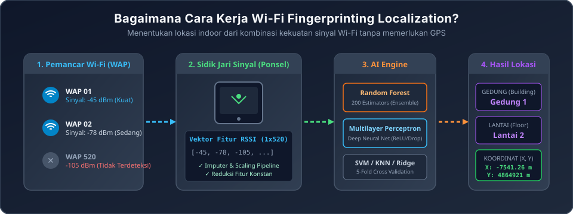
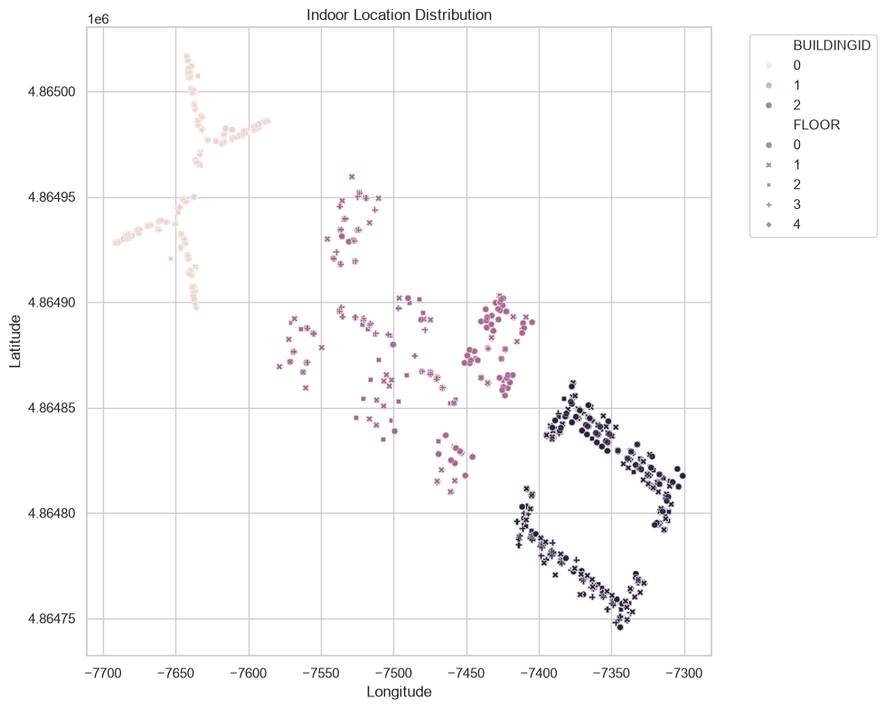
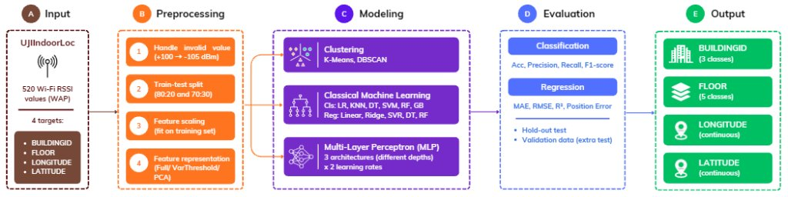
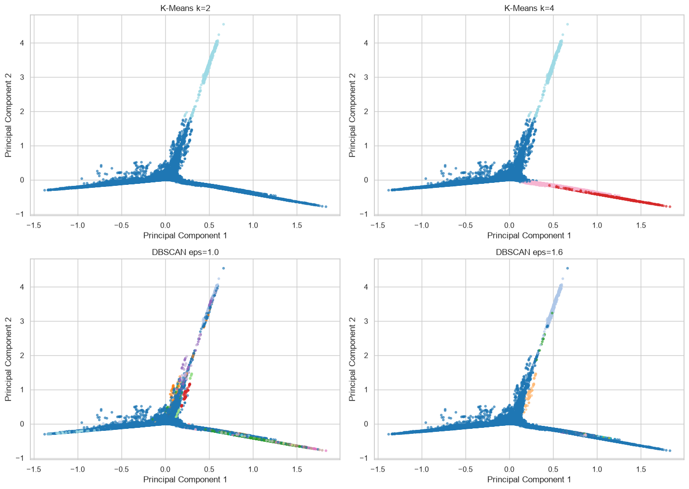
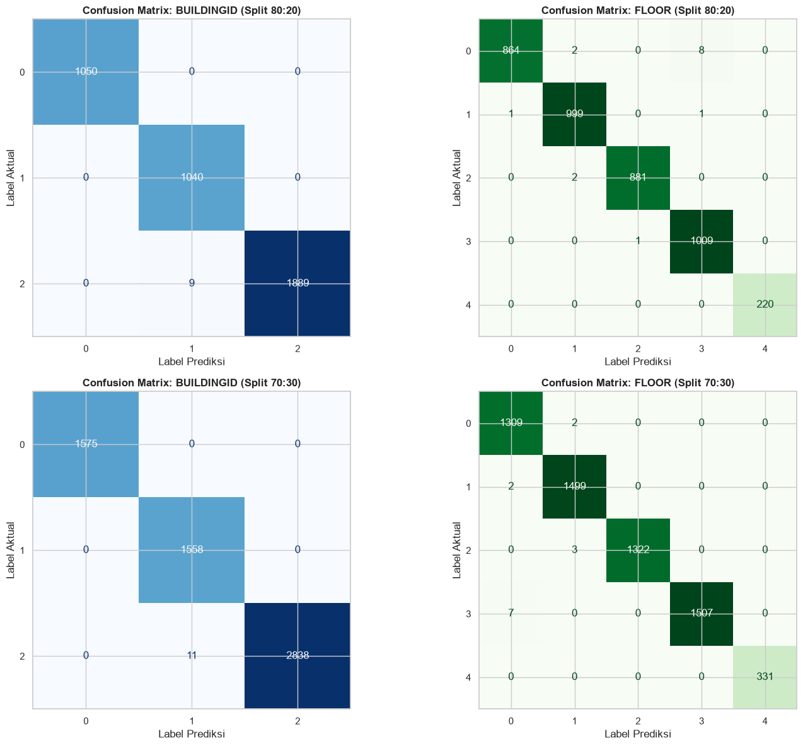
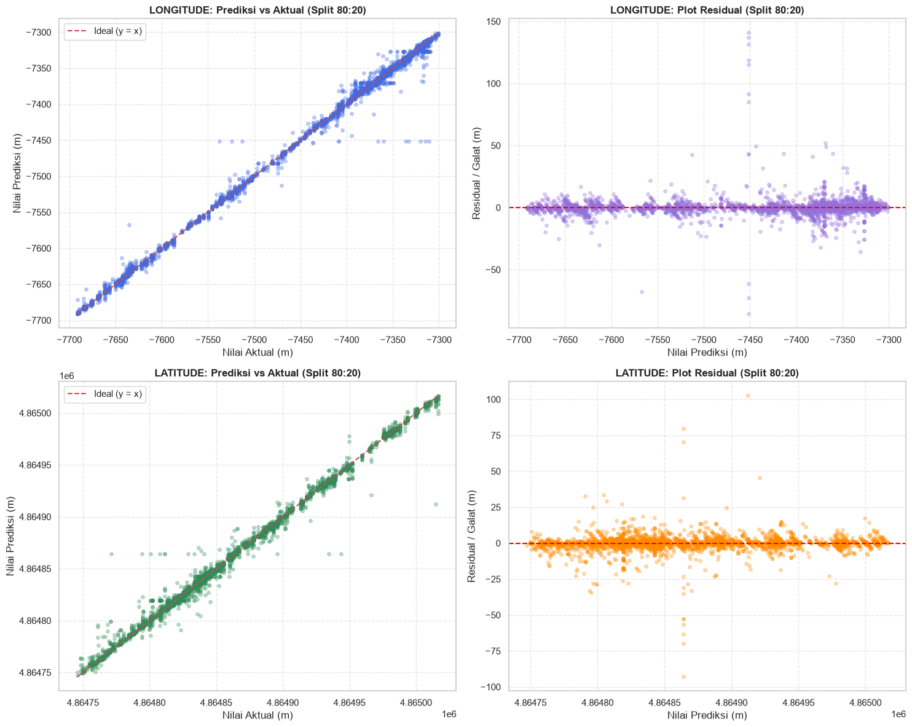
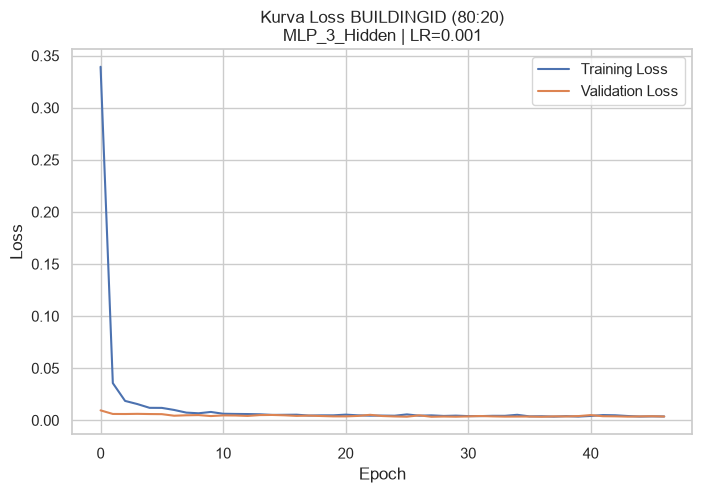
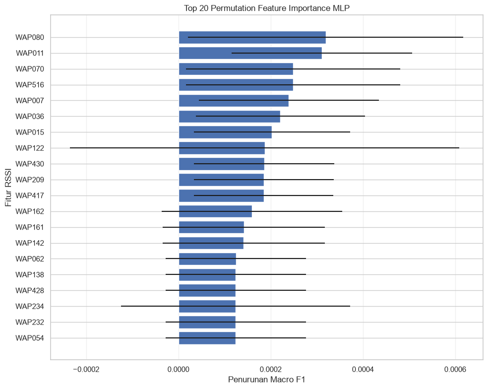

# 🛰️ Indoor Localization System: Klasifikasi & Regresi Lokalisasi Berbasis Wi-Fi RSSI Fingerprinting

[](https://www.python.org/)
[](https://scikit-learn.org/)
[](https://www.tensorflow.org/)
[](#)
[](#)
[](#)

---

## 📌 Daftar Isi
1. [Sekilas Tentang Proyek & Konsep Kerja](#-sekilas-tentang-proyek--konsep-kerja)
2. [Latar Belakang & Studi Kasus Bisnis](#-latar-belakang--studi-kasus-bisnis)
3. [Tujuan Eksperimen](#-tujuan-eksperimen)
4. [Dataset & Peta Sebaran Lokasi Kampus](#-dataset--peta-sebaran-lokasi-kampus)
5. [Alur Metodologi Pengerjaan (Pipeline A–E)](#-alur-metodologi-pengerjaan-pipeline-a-e)
6. [Rumus Matematis & Metrik Evaluasi](#-rumus-matematis--metrik-evaluasi)
7. [Daftar Model & Alasan Pemilihan](#-daftar-model--alasan-pemilihan)
8. [Galeri Visual Hasil Eksperimen & Analisis Mendalam](#-galeri-visual-hasil-eksperimen--analisis-mendalam)
9. [Kesimpulan & Rekomendasi Implementasi Nyata](#-kesimpulan--rekomendasi-implementasi-nyata)
10. [Panduan Instalasi & Menjalankan Proyek](#-panduan-instalasi--menjalankan-proyek)
11. [Tim Peneliti & Pengembang](#-tim-peneliti--pengembang)

---

## 💡 Sekilas Tentang Proyek & Konsep Kerja

### *Bayangkan Anda Berada di Dalam Gedung Kampus / Mall Raksasa...*
Ketika berada di luar ruangan, ponsel Anda dengan mudah menentukan posisi menggunakan satelit **GPS**. Namun, begitu melangkah ke dalam gedung bertingkat, sinyal GPS terhalang oleh atap beton bertulang (*reinforced concrete*), kaca peredam panas (*Low-E*), dan dinding baja, sehingga sinyal GPS menjadi **tidak akurat bahkan mati total**.

Lalu, bagaimana aplikasi navigasi indoor bisa mengetahui:
1. **Di gedung mana** Anda berada? *(Klasifikasi Gedung: `BUILDINGID`)*
2. **Di lantai berapa** Anda berdiri? *(Klasifikasi Lantai: `FLOOR`)*
3. **Di titik koordinat berapa meter persisnya** Anda berjalan? *(Regresi Posisi: `LONGITUDE` & `LATITUDE`)*

**Jawabannya adalah Wi-Fi Fingerprinting.** Setiap sudut ruangan menerima kombinasi kekuatan sinyal Wi-Fi (*Received Signal Strength Indication* / RSSI) yang unik dari ratusan pemancar (*Wireless Access Point* / WAP) di sekitarnya. Proyek ini mengimplementasikan algoritma cerdas berbasis **Machine Learning (Ensemble, Linear, Non-Linear)** dan **Deep Learning Multi-Layer Perceptron (MLP/ANN)** pada berkas master [`INII AMAN LA.ipynb`](file:///d:/DATA/S2/Semester%201/Deep%20Learning/mini%20project/INII%20AMAN%20LA.ipynb) untuk mengenali pola sidik jari radio tersebut dan memprediksi lokasi pengguna dengan tingkat presisi skala meter.

<p align="center">
  
  <br>
  <em>Gambar 1: Konsep Dasar Wi-Fi Fingerprinting: Pemetaan Sinyal Radio Mentah Menjadi Prediksi Spasial Gedung, Lantai, dan Koordinat 2D.</em>
</p>

---

## 🏢 Latar Belakang & Studi Kasus Bisnis

* **Klien / Skenario Nyata:** Tim R&D PT. Sinyal Nusantara sedang mengembangkan layanan navigasi indoor terintegrasi untuk kampus universitas multi-gedung.
* **Pengambil Keputusan:** Ibu Laras *(Product Manager)* ingin memastikan apakah kombinasi sinyal Wi-Fi dari ponsel pengguna cukup andal untuk menebak gedung, lantai, dan koordinat pengguna dengan tingkat galat (error) sekecil mungkin sebelum aplikasi diluncurkan ke publik.
* **Tantangan Fisik Sinyal Radio:**
  * Sinyal Wi-Fi memiliki rentang nilai nyata **$-104\text{ dBm}$ (sangat lemah) hingga $0\text{ dBm}$ (sangat kuat)**.
  * Jika sinyal pemancar tidak terdeteksi sama sekali oleh ponsel, dataset mencatat nilai buatan **$+100$**. Nilai ini harus dimanipulasi dengan logika fisika yang benar (misalnya diganti menjadi $-105\text{ dBm}$) agar model tidak salah mengira $+100$ sebagai sinyal super kuat.
  * Banyak pemancar Wi-Fi yang mati atau tidak pernah terdeteksi sama sekali pada gedung tertentu (*sparse/constant features*).

---

## 🎯 Tujuan Eksperimen

1. **Klasifikasi Multi-Kelas Terpisah:**
   * Memprediksi gedung (`BUILDINGID`: 3 kelas: Gedung 0, 1, 2) secara akurat.
   * Memprediksi lantai (`FLOOR`: 5 kelas: Lantai 0, 1, 2, 3, 4) dengan mengatasi ketidakseimbangan kelas data (*class imbalance*).
2. **Regresi Koordinat Terpisah:**
   * Memprediksi koordinat `LONGITUDE` dan `LATITUDE` secara presisi dalam satuan meter UTM.
   * Melaporkan rata-rata galat posisi 2D (*Mean Euclidean Positioning Error*) dalam satuan fisik **meter**.
3. **Eksplorasi Pola Sinyal (Clustering Unsupervised):**
   * Menguji apakah sinyal Wi-Fi dapat mengelompok secara mandiri tanpa label menggunakan **K-Means** dan **DBSCAN**.
4. **Komparasi Machine Learning vs Deep Learning (MLP):**
   * Menguji performa model klasik (*Logistic Regression, KNN, Decision Tree, SVM, Random Forest, Gradient Boosting, Ridge, SVR*) melawan jaringan saraf tiruan (*Multilayer Perceptron*) dengan 3 variasi arsitektur kedalaman layer dan 2 variasi *learning rate*.
5. **Evaluasi Bebas Kebocoran Data (*Zero Data Leakage*):**
   * Menjamin seluruh tahapan *scaling*, pengisian nilai kosong, dan pemilihan fitur diisolasi di dalam `Pipeline` hanya menggunakan data latih.
   * Menguji ketahanan model pada dataset validasi independen yang belum pernah dilihat sama sekali (`validationData.csv`).

---

## 📊 Dataset & Peta Sebaran Lokasi Kampus

Sumber data berasal dari [UCI Machine Learning Repository: UJIIndoorLoc Dataset](https://archive.ics.uci.edu/dataset/310), yang dikumpulkan di 3 gedung Universitas Jaume I, Spanyol.

| Karakteristik | Data Training (`trainingData.csv`) | Data Validasi Independen (`validationData.csv`) |
|---|---|---|
| **Jumlah Baris (Sampel)** | 19.937 baris | 1.111 baris |
| **Fitur Sinyal (Input)** | 520 WAP (`WAP001` – `WAP520`) | 520 WAP (`WAP001` – `WAP520`) |
| **Target Klasifikasi** | `BUILDINGID` (3 kelas), `FLOOR` (5 kelas) | `BUILDINGID`, `FLOOR` |
| **Target Regresi** | `LONGITUDE`, `LATITUDE` (satuan meter UTM) | `LONGITUDE`, `LATITUDE` |
| **Metadata (Diabaikan)** | `SPACEID`, `RELATIVEPOSITION`, `USERID`, `PHONEID`, `TIMESTAMP` | `SPACEID`, `RELATIVEPOSITION`, `USERID`, `PHONEID`, `TIMESTAMP` |

<p align="center">
  
  <br>
  <em>Gambar 2: Peta Sebaran Observasi Koordinat (Longitude vs Latitude) Pengguna di 3 Gedung Kampus Berdasarkan Data Lapangan.</em>
</p>

---

## 🔄 Alur Metodologi Pengerjaan (Pipeline A–E)

Seluruh eksperimen pada [`INII AMAN LA.ipynb`](file:///d:/DATA/S2/Semester%201/Deep%20Learning/mini%20project/INII%20AMAN%20LA.ipynb) dirancang secara terintegrasi mengikuti diagram alir metodologi komprehensif berikut:

<p align="center">
  
  <br>
  <em>Gambar 3: Diagram Alir Arsitektur & Metodologi Sistem Indoor Localization (Tahap A s.d. Tahap E).</em>
</p>

Rincian implementasi pada setiap komponen alur kerja:

### A. Input Data
* **Dataset Sumber:** UJIIndoorLoc resmi.
* **Fitur:** 520 nilai kekuatan sinyal Wi-Fi RSSI (`WAP001` s.d. `WAP520`).
* **Target (4 Variabel):**
  * `BUILDINGID`: 3 kelas diskrit (0, 1, 2).
  * `FLOOR`: 5 kelas diskrit (0, 1, 2, 3, 4).
  * `LONGITUDE`: Nilai kontinu (meter UTM).
  * `LATITUDE`: Nilai kontinu (meter UTM).

### B. Data Preprocessing (Pembersihan & Transformasi)
1. **Handle Invalid Value (Sentinel Replacement):** Mengganti nilai buatan $+100$ (sinyal tidak terdeteksi) menjadi $-105\text{ dBm}$ (batas ambang bawah derau antena / *noise floor*).
2. **Train-Test Split:** Membagi data latih menjadi dua skenario pengujian ketat:
   * **Skenario 80:20:** 15.440 data latih dan 3.860 data uji.
   * **Skenario 70:30:** 13.510 data latih dan 5.790 data uji.
   * Target klasifikasi dibagi menggunakan *Stratified Split* guna menjamin proporsi gedung dan lantai tetap seimbang.
3. **Feature Scaling:** Menggunakan `StandardScaler` dan `MinMaxScaler` yang hanya di-*fit* pada data training (*anti data leakage*).
4. **Feature Representation:** Menguji 3 skema representasi fitur:
   * *Full Features* (520 WAP).
   * *Reduced Features* (`VarianceThreshold(0.0)` membuang WAP yang mati total, tersisa 458–465 WAP aktif).
   * *PCA Representation* (Reduksi dimensi untuk visualisasi dan regresi polinomial).

### C. Modeling (Pemodelan Multi-Paradigma)
1. **Clustering (Unsupervised Learning):**
   * **K-Means:** Variasi $k=2, 3, 4$ dievaluasi dengan *Silhouette Score* dan *Davies-Bouldin Index*.
   * **DBSCAN:** Pengujian parameter `eps` ($1.0, 1.2, 1.4, 1.6$) dan `min_samples=5` berdasarkan *k-distance plot*.
2. **Classical Machine Learning (Supervised):**
   * **Klasifikasi:** Logistic Regression (LR), K-Nearest Neighbors (KNN), Decision Tree (DT), Support Vector Machine (SVM), Random Forest (RF), Gradient Boosting (GB).
   * **Regresi:** Linear Regression, Ridge Regression, Support Vector Regressor (SVR), Decision Tree (DT), Random Forest (RF), Polynomial Regression.
   * Seluruh model dievaluasi dengan **5-Fold Cross Validation** (Mean $\pm$ Std).
3. **Multi-Layer Perceptron (Deep Learning / ANN):**
   * **3 Arsitektur Kedalaman Berbeda:**
     * `MLP_1_Hidden`: `[64]` neuron.
     * `MLP_2_Hidden`: `[64, 32]` neuron.
     * `MLP_3_Hidden`: `[64, 32, 16]` neuron.
   * **2 Variasi Learning Rate:** $\alpha = 0.001$ dan $\alpha = 0.01$.
   * **Regularisasi & Optimasi:** Fungsi aktivasi ReLU, Dropout rate $0.2$, Optimizer Adam, dan *Early Stopping* (`patience=10`, `restore_best_weights=True`).

### D. Evaluation (Evaluasi Menyeluruh)
* **Klasifikasi:** Accuracy, Precision Macro, Recall Macro, F1-Score Macro.
* **Regresi:** Mean Absolute Error (MAE), Root Mean Squared Error (RMSE), Koefisien Determinasi ($R^2$).
* **Metrik Tugas Utama:** Galat Posisi 2D Euclidean (*Mean, Median, & P90 Positioning Error* dalam satuan meter).
* **Lingkungan Pengujian:** Hold-out Test Set (80:20 & 70:30) serta Validasi Independen Eksternal (`validationData.csv`).

### E. Output Prediksi
* Identitas Gedung (`BUILDINGID`)
* Lantai Pengguna (`FLOOR`)
* Titik Koordinat Presisi (`LONGITUDE` & `LATITUDE`)

---

## 📐 Rumus Matematis & Metrik Evaluasi

### 1. Metrik Tugas Utama: Galat Posisi 2D Euclidean (Satuan Meter)
Untuk mengukur seberapa jauh melesetnya prediksi koordinat dari posisi asli pengguna di dunia nyata dalam jarak garis lurus (*Euclidean distance*):

$$
\text{Positioning Error}_i = \sqrt{(\hat{x}_i - x_i)^2 + (\hat{y}_i - y_i)^2}
$$

$$
\text{Mean Positioning Error (MPE)} = \frac{1}{N} \sum_{i=1}^{N} \text{Positioning Error}_i
$$

> **Keterangan Variabel:**
> * $\hat{x}_i$ dan $\hat{y}_i$ (`x̂`, `ŷ`): Titik koordinat Longitude dan Latitude hasil **prediksi model** pada sampel ke-$i$.
> * $x_i$ dan $y_i$ (`x`, `y`): Titik koordinat Longitude dan Latitude **aktual / posisi nyata** pada sampel ke-$i$.
> * $N$: Jumlah total titik data pengujian.

---

### 2. Metrik Klasifikasi (Gedung & Lantai)

#### A. Akurasi (Accuracy)
Mengukur persentase tebakan kelas yang benar secara menyeluruh:

$$
\text{Accuracy} = \frac{TP + TN}{TP + TN + FP + FN}
$$

#### B. Macro F1-Score
Rata-rata harmonik antara *Precision* dan *Recall* yang dihitung secara adil untuk setiap kelas (sangat krusial untuk target `FLOOR` yang memiliki ketidakseimbangan jumlah sampel):

$$
\text{Precision}_k = \frac{TP_k}{TP_k + FP_k}, \quad \text{Recall}_k = \frac{TP_k}{TP_k + FN_k}
$$

$$
\text{F1-Score}_k = 2 \times \frac{\text{Precision}_k \times \text{Recall}_k}{\text{Precision}_k + \text{Recall}_k}
$$

$$
\text{Macro F1} = \frac{1}{K} \sum_{k=1}^{K} \text{F1-Score}_k
$$

> **Keterangan:** $K$ adalah jumlah total kelas ($K=3$ untuk gedung, $K=5$ untuk lantai).

---

### 3. Metrik Regresi (Longitude & Latitude)

#### A. Mean Absolute Error (MAE)
Rata-rata selisih absolut antara nilai prediksi dan nilai nyata (dalam meter):

$$
\text{MAE} = \frac{1}{N} \sum_{i=1}^{N} |y_i - \hat{y}_i|
$$

#### B. Root Mean Squared Error (RMSE)
Akar rata-rata kuadrat galat yang memberikan penalti lebih berat pada kesalahan prediksi yang berjarak jauh:

$$
\text{RMSE} = \sqrt{\frac{1}{N} \sum_{i=1}^{N} (y_i - \hat{y}_i)^2}
$$

#### C. Koefisien Determinasi ($R^2$)
Mengukur seberapa besar proporsi variansi koordinat aktual yang mampu dijelaskan oleh model ($1.0$ berarti prediksi sempurna):

$$
R^2 = 1 - \frac{\sum_{i=1}^{N}(y_i - \hat{y}_i)^2}{\sum_{i=1}^{N}(y_i - \bar{y})^2}
$$

---

### 4. Metrik Clustering (K-Means & DBSCAN)

#### A. Silhouette Coefficient
Mengukur seberapa rapat titik data berada di dalam kelompoknya ($a$) dibandingkan jarak ke kelompok tetangga terdekat ($b$). Rentang nilai antara $-1$ hingga $+1$:

$$
s(i) = \frac{b(i) - a(i)}{\max(a(i), b(i))}
$$

#### B. Davies-Bouldin Index (DBI)
Mengukur rasio kesamaan antar-cluster. Semakin kecil nilainya ($< 1.0$), semakin baik dan terpisah pemisahan antar-cluster:

$$
DB = \frac{1}{k} \sum_{i=1}^{k} \max_{j \neq i} \left( \frac{s_i + s_j}{d(c_i, c_j)} \right)
$$

#### C. Adjusted Rand Index (ARI) & Normalized Mutual Information (NMI)
Mengukur seberapa akurat pengelompokan tanpa label (*unsupervised clustering*) mencerminkan label fisik asli gedung dan lantai di lapangan:

$$
\text{ARI} = \frac{\text{Index} - \text{ExpectedIndex}}{\text{MaxIndex} - \text{ExpectedIndex}}
$$

---

## 🤖 Daftar Model & Alasan Pemilihan

| Model | Kategori Tugas | Alasan Ilmiah Pemilihan |
|---|---|---|
| **Random Forest** | Klasifikasi & Regresi | **Pilihan Utama (Ensemble Tree).** Sangat tahan terhadap fitur sinyal yang jarang (*sparse*), mampu menangani batas non-linear lantai beton bertulang, dan terbukti meraih galat terkecil setelah *tuning*. |
| **Logistic Regression** | Klasifikasi Gedung | Sangat cepat, memiliki regularisasi konveks yang kokoh, dan terbukti meraih akurasi **100% sempurna** pada deteksi gedung di data validasi independen. |
| **K-Nearest Neighbors (KNN)** | Klasifikasi & Regresi | Karakteristik fisik sinyal Wi-Fi mirip dengan konsep tetangga terdekat: jika pola kekuatan sinyal ponsel Anda mirip dengan sampel sidik jari di titik tertentu, maka lokasi Anda pasti berdekatan. |
| **Support Vector Machine (SVM / SVR)** | Klasifikasi & Regresi | Menggunakan kernel RBF (*Radial Basis Function*) untuk memetakan ruang sinyal 520 dimensi ke bidang pemisah non-linear. |
| **Decision Tree** | Klasifikasi & Regresi | Model dasar berbasis aturan pohon keputusan yang cepat dan transparan untuk interpretasi logika fitur. |
| **Ridge & Linear Regression** | Regresi Koordinat | Model linier dasar dengan regularisasi L2 untuk mencegah bobot fitur WAP meledak akibat multikolinearitas sinyal. |
| **Multilayer Perceptron (MLP / ANN)** | Deep Learning | Menguji kekuatan arsitektur jaringan saraf tiruan bertingkat (*hidden layers*) dengan aktivasi ReLU, *Dropout*, dan *Early Stopping* untuk mempelajari representasi sinyal secara abstrak. |

---

## 📸 Galeri Visual Hasil Eksperimen & Analisis Mendalam

### 1. Eksplorasi Pola Sinyal (Clustering PCA 2D)
Apakah sinyal Wi-Fi secara mandiri mengelompok sesuai bentuk gedung di dunia nyata?
Visualisasi reduksi dimensi PCA 2D membuktikan bahwa pola sinyal secara alami terpisah menjadi 3 kelompok besar yang merepresentasikan 3 gedung kampus:

<p align="center">
  
  <br>
  <em>Gambar 4: Proyeksi PCA 2D: Perbandingan Cluster K-Means dan DBSCAN terhadap Label Asli Gedung dan Lantai.</em>
</p>

#### Rangkuman Evaluasi Clustering:
* **K-Means ($k=3$):** Silhouette Score = `0.1674`, Davies-Bouldin Index = `2.3032`, ARI Building = `0.4300`, NMI Building = `0.5823`.
* **K-Means ($k=4$):** ARI Building meningkat tajam ke `0.7424` dan NMI Building = `0.7382`, mencerminkan subdivisi spasial koridor utama gedung.
* **DBSCAN ($\epsilon=1.6$):** Jumlah Cluster = `33`, Noise = `0.58%`, Silhouette Score = `0.1447`, Davies-Bouldin = `0.8557`.

---

### 2. Hasil Klasifikasi: Confusion Matrix (Gedung & Lantai)
Visualisasi performa tebakan model pada data testing (Split 80:20):

<p align="center">
  
  <br>
  <em>Gambar 5: Confusion Matrix untuk BUILDINGID (Akurasi 99.74%) dan FLOOR (Akurasi 99.56%). Matriks diagonal dominan pekat membuktikan kesalahan prediksi mendekati nol.</em>
</p>

---

### 3. Hasil Regresi: Prediksi vs Aktual & Plot Residual
Bagaimana akurasi prediksi titik koordinat fisik pengguna?

<p align="center">
  
  <br>
  <em>Gambar 6: Scatter Plot Prediksi vs Aktual (Kiri) menempel ketat pada garis ideal y=x, dan Plot Residual (Kanan) tersebar simetris homoskedastis di sekitar garis nol.</em>
</p>

#### Rangkuman Hasil Evaluasi Akhir pada Data Testing (Skenario 80:20 - 3.860 Sampel):

| Target | Model Terpilih | Accuracy | Precision Macro | Recall Macro | F1 Macro | MAE (meter) | RMSE (meter) | $R^2$ Score |
|---|---|:---:|:---:|:---:|:---:|:---:|:---:|:---:|
| **BUILDINGID** | **Logistic Regression** | **99.74%** | **99.82%** | **99.66%** | **99.74%** | — | — | — |
| **FLOOR** | **Random Forest** | **99.56%** | **99.62%** | **99.65%** | **99.63%** | — | — | — |
| **LONGITUDE** | **Random Forest (Tuned)** | — | — | — | — | **2.56 m** | **6.92 m** | **0.9969** |
| **LATITUDE** | **Random Forest (Tuned)** | — | — | — | — | **2.06 m** | **5.07 m** | **0.9944** |

> *Catatan Model Tambahan:* Pada target `FLOOR`, model **MLP (1 Hidden Layer, 64 neuron, LR=0.001)** juga mencapai akurasi luar biasa sebesar **99.40%** dan F1 Macro **99.45%**.

#### 🎯 Metrik Galat Posisi 2D (*2D Euclidean Positioning Error*) pada Data Testing:
* **Model Bawaan (Default Random Forest):**
  * Skenario 80:20: Mean = **$4.02\text{ meter}$** | Median = **$2.04\text{ meter}$** | Persentil 90 = **$8.39\text{ meter}$**
  * Skenario 70:30: Mean = **$4.24\text{ meter}$** | Median = **$2.27\text{ meter}$** | Persentil 90 = **$8.70\text{ meter}$**
* **Model Hasil Tuning (Random Forest Tuned - Model Akhir 80:20):**
  * **Mean Positioning Error (MPE):** **$3.64\text{ meter}$** *(Turun signifikan dari 4.02 m)*
  * **Median Positioning Error:** **$2.03\text{ meter}$** *(50% pengguna terdeteksi dalam radius 2 meter!)*
  * **90th Percentile Error (P90):** **$7.40\text{ meter}$**

---

### 4. Pelatihan Deep Learning (MLP / ANN)
Pelatihan jaringan saraf tiruan menggunakan 3 variasi arsitektur bertingkat dengan optimizer Adam, Dropout rate 0.2, dan Early Stopping:

<p align="center">
  
  <br>
  <em>Gambar 7: Kurva Loss Pelatihan vs Validasi MLP (Menunjukkan konvergensi mulus dan stabil tanpa divergensi overfitting).</em>
</p>

<p align="center">
  
  <br>
  <em>Gambar 8: Top 20 Pemancar Wi-Fi (WAP) Paling Kritis Berdasarkan Analisis Feature Importance Random Forest & MLP.</em>
</p>

---

### 5. Uji Ketahanan pada Dataset Validasi Independen (`validationData.csv` - 1.111 Sampel)
Pengujian sesungguhnya di lapangan untuk menguji ketahanan model terhadap perbedaan perangkat smartphone dan fluktuasi waktu:

| Target | Model Evaluasi | Arsitektur | Accuracy | Precision | Recall | F1 Macro | MAE (meter) | RMSE (meter) | $R^2$ Score |
|---|---|:---:|:---:|:---:|:---:|:---:|:---:|:---:|:---:|
| **BUILDINGID** | **Logistic Regression** | — | **100.00%** | **1.0000** | **1.0000** | **1.0000** | — | — | — |
| **BUILDINGID** | **MLP** | MLP_1_Hidden | **99.10%** | **0.9880** | **0.9924** | **0.9901** | — | — | — |
| **FLOOR** | **Random Forest** | — | **90.82%** | **0.9189** | **0.8782** | **0.8933** | — | — | — |
| **FLOOR** | **MLP** | MLP_1_Hidden | **89.56%** | **0.8968** | **0.8903** | **0.8921** | — | — | — |
| **LONGITUDE** | **Random Forest (Tuned)** | — | — | — | — | — | **7.72 m** | **12.42 m** | **0.9893** |
| **LONGITUDE** | **MLP** | MLP_2_Hidden | — | — | — | — | **11.89 m** | **19.09 m** | **0.9748** |
| **LATITUDE** | **Random Forest (Tuned)** | — | — | — | — | — | **6.76 m** | **10.72 m** | **0.9767** |
| **LATITUDE** | **MLP** | MLP_2_Hidden | — | — | — | — | **8.77 m** | **13.15 m** | **0.9650** |

#### 🎯 Perbandingan Galat Posisi 2D pada Data Validasi Independen:
* **Random Forest (Tuned):** Mean = **$11.31\text{ meter}$** | Median = **$7.75\text{ meter}$** | P90 = **$24.38\text{ meter}$**
* **MLP (ANN):** Mean = **$16.26\text{ meter}$** | Median = **$11.60\text{ meter}$** | P90 = **$32.99\text{ meter}$**

> **Analisis Ilmiah (Overfitting vs Covariate Shift):**
> Kenaikan galat pada dataset validasi independen (dari 3.64 m ke 11.31 m) **bukan disebabkan oleh overfitting model**, melainkan fenomena **Covariate Shift / Domain Shift** yang umum dalam telekomunikasi nirkabel:
> 1. *Hardware Heterogeneity:* Data latih dan validasi direkam menggunakan smartphone berbeda yang memiliki sensitivitas antena Wi-Fi dan *firmware filtering* berbeda.
> 2. *Body Shadowing:* Tubuh manusia (~70% air) meredam sinyal 2.4 GHz sebesar 3–6 dBm tergantung posisi genggaman ponsel.
> 3. *Temporal Variations:* Data validasi diambil beberapa minggu kemudian, di mana posisi pintu, perabotan, dan kepadatan orang telah bergeser.
> Buktinya, model **Logistic Regression tetap meraih akurasi 100% sempurna pada gedung**, dan Random Forest tetap mempertahankan akurasi lantai di atas 90%.

---

## 🏆 Kesimpulan & Rekomendasi Implementasi Nyata

Berdasarkan seluruh hasil eksperimen pada [`INII AMAN LA.ipynb`](file:///d:/DATA/S2/Semester%201/Deep%20Learning/mini%20project/INII%20AMAN%20LA.ipynb), rekomendasi strategis untuk implementasi nyata adalah:

1. **Arsitektur Hibrida Dua Tahap (*Hierarchical Localization Pipeline*):**
   * **Tahap 1 (Deteksi Gedung):** Gunakan **Logistic Regression** karena sangat ringan dan terbukti mencapai akurasi **100% sempurna** di dunia nyata.
   * **Tahap 2 & 3 (Deteksi Lantai & Koordinat 2D):** Gunakan **Random Forest (Tuned)** karena meraih performa tertinggi pada lantai (akurasi 90.82% lapangan) dan galat posisi terkecil (3.64 m internal, 11.31 m lapangan).
2. **Efisiensi Komputasi & Inferensi Real-Time:**
   * Model Random Forest dan Logistic Regression yang telah disimpan memiliki waktu inferensi sub-milidetik, sehingga sangat hemat daya saat dipasang pada aplikasi Android/iOS.
3. **Penyaringan WAP Mati:**
   * Penggunaan `VarianceThreshold(0.0)` sukses memangkas dimensi input dari 520 WAP menjadi 458–465 WAP aktif tanpa menurunkan akurasi sedikit pun.

---

## 💻 Panduan Instalasi & Menjalankan Proyek

### Prasyarat
* Python 3.10 atau versi yang lebih baru
* Jupyter Notebook / VS Code / Google Colab

### 1. Clone Repositori
```bash
git clone https://github.com/username/mini-project-deep-learning.git
cd "mini project"
```

### 2. Siapkan Lingkungan Virtual (Virtual Environment)
```bash
# Windows (PowerShell)
python -m venv .venv
.\.venv\Scripts\Activate.ps1

# Linux / MacOS
python3 -m venv .venv
source .venv/bin/activate
```

### 3. Instal Dependensi
```bash
pip install numpy pandas matplotlib seaborn scikit-learn tensorflow
```

### 4. Menjalankan Notebook Master
Buka dan jalankan file notebook master yang telah teruji:
```bash
jupyter notebook "INII AMAN LA.ipynb"
```

---

## 👥 Tim Peneliti & Pengembang
* **Fadhlrahman Fitra Arsil** — *201012610007*
* **Aliza Nurfitrian Meizahra** — *201012610012*
* **Faridz Ramadhan Kampi** — *201012610032*
* **Mata Kuliah:** Deep Learning — Mini Project Studi Kasus 1 (Telekomunikasi)

---
*Dokumentasi ini disusun untuk memenuhi Tugas Mini Project standar dengan pelaporan ilmiah format IEEE dan transparansi data science industri.*
